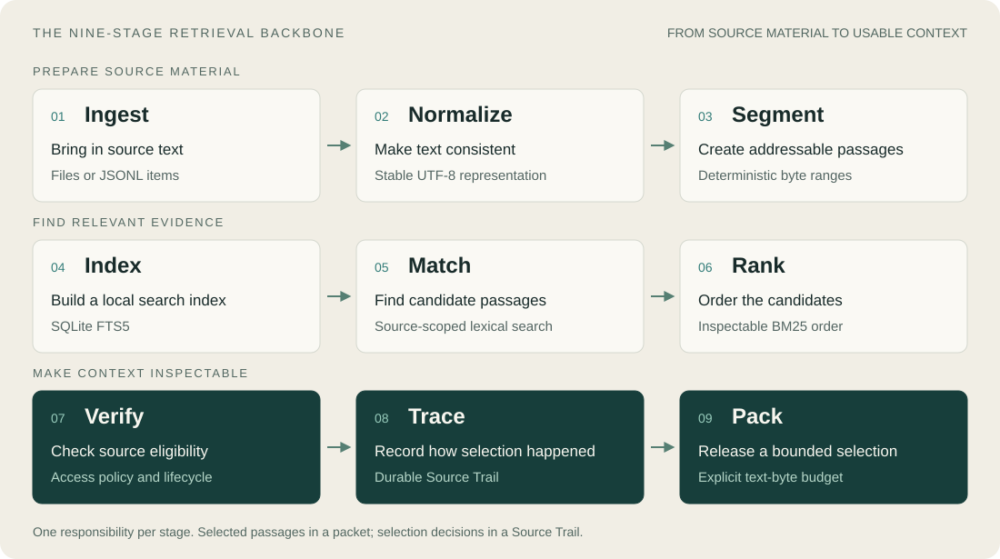

# Useful context. A trail back to its source.

**Mousa turns local documents into compact, source-linked context for agents and applications.**
Search your material, set a byte budget, and receive passages with an inspectable
record of how they were selected.

[Quick start](#quick-start) · [Usage guide](docs/USAGE.md) · [Capabilities](docs/CAPABILITIES.md) · [Public benchmarks](https://github.com/graydeon/mousa-benchmarks)

## Why Mousa?

*Mousa* is the Ancient Greek singular of *Muse*. In Greek mythology,
Mnemosyne—the Titan goddess of memory—is the mother of the nine Muses.
The name gives Mousa a practical organizing idea: durable memory is not one act.
Sources move through nine explicit stages before they become usable context.

## Nine stages, one inspectable path



Mousa prepares your material, finds matching evidence, and assembles a context packet
with a Source Trail. Each stage has one responsibility; the diagram shows the
logical backbone rather than the exact order of database operations.

Today, search is lexical and verification covers source access and lifecycle.
Semantic search, factual freshness and semantic conflict checks remain planned.
[Explore each stage and its implementation boundary →](docs/OVERVIEW.md#the-nine-stage-retrieval-backbone)

> **Pre-alpha.** CLI and local stdio MCP are available. Build from source with
> Go 1.25+. Packages are internal; there is no stable SDK.

## Why use it?

An agent needs relevant context without carrying every document into every request.
Mousa makes that context smaller and easier to inspect:

| Your need | What Mousa gives you |
|---|---|
| Find useful passages | Local, source-scoped lexical search over your text. |
| Control context size | An explicit released-text byte budget and optional exact-content deduplication. |
| Follow the evidence | Source identities, passage coordinates, digests and a durable Source Trail. |
| Keep up with edits | Resync current items while preserving canonical history. |
| Use your own tools | One Go executable, SQLite storage, JSON output and local stdio MCP. |

Mousa retrieves evidence; your agent or application decides how to use it.
It does not generate answers or determine whether a passage is factually true.

## Quick start

From the repository root, build Mousa and index a directory of Markdown or text files:

```sh
CGO_ENABLED=0 go build -o mousa ./cmd/mousa
./mousa -store local.sqlite sync --preview ./documents
./mousa -store local.sqlite sync ./documents
./mousa -store local.sqlite query --budget-bytes 4096 ./documents 'harbor inspection'
```

Commands return JSON. A query reports selected evidence, a context packet ID and a
`trail_id`. Inspect that trail with:

```sh
./mousa -store local.sqlite trail ./documents TRAIL_ID
```

Replace `TRAIL_ID` with the query's returned identifier. The 4,096-byte budget covers
released passage text, not JSON overhead or model tokens. Preview shows what would
be imported without opening the store.

**Next:** [directory selection and resync](docs/USAGE.md#local-usage-cmdmousa),
[JSONL input and administration](docs/USAGE.md#local-usage-cmdmousa), or
[MCP setup](docs/USAGE.md#local-mcp-usage).

## What works today?

Local directory and JSONL ingestion, lexical retrieval, source lifecycle and access
checks, byte-budget packing, exact-content deduplication, declared associations and
Source Trail inspection are implemented. The same executable serves local stdio MCP.

Revision-pinned supersession declarations and activation administration are available,
together with an explicit native JSONL query opt-in
(`query --source <id> --supersession <text>`) and the same opt-in on the local stdio MCP
`mousa_query` tool. Default and opted-out queries remain uncurated and
withhold nothing; opt-in usage, response fields and the validation boundary are in the
[usage guide](docs/USAGE.md#local-usage-cmdmousa). Semantic retrieval, hybrid ranking,
secret filtering and full model-window budgeting remain planned.

The [capability matrix](docs/CAPABILITIES.md) is the detailed supported-behavior reference.
The [research record](docs/RESEARCH.md) separates regression coverage from measured
retrieval quality and performance.

## Explore

| Start here | For |
|---|---|
| [Usage guide](docs/USAGE.md) | CLI commands, input limits, administration and consumer examples. |
| [MCP and host integration](docs/USAGE.md#local-mcp-usage) | Local tool setup, project-history consumer, ChatGPT desktop and Codex CLI. |
| [How Mousa works](docs/OVERVIEW.md) | The nine-stage pipeline, Source Trails and design principles. |
| [Capability matrix](docs/CAPABILITIES.md) | Supported interfaces, exact contracts and limitations. |
| [Research and public benchmarks](docs/RESEARCH.md) | Reproducible observations, pinned revisions and their evidence boundaries. |
| [Supersession contract](docs/SUPERSESSION_ENFORCEMENT.md) | Revision-pinned replacement and the implemented native opt-in enforcement boundary. |

## Contributing

See [CONTRIBUTING.md](CONTRIBUTING.md) for issue and pull request templates,
required author-review attestations, testing evidence, and issue linking.

## Credits

README banner portrait source: Dante Gabriel Rossetti, *Mnemosyne* (c. 1876–1881), Delaware Art Museum, accession 1935-22. [Public-domain reproduction via Wikimedia Commons](https://commons.wikimedia.org/wiki/File:Mnemosyne_DAM.jpg). Materially transformed for Mousa.

## License

Mousa is licensed under the GNU Affero General Public License v3.0. See [`LICENSE`](LICENSE).
