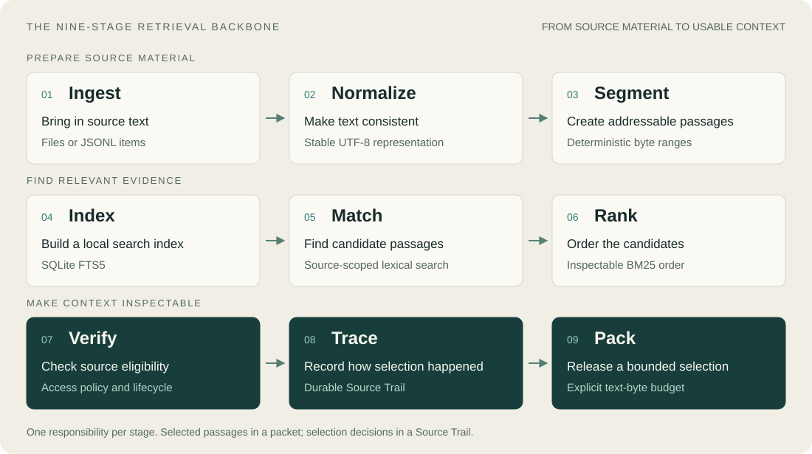

# Useful context. A trail back to its source.

**Mousa turns local documents into compact, source-linked context for agents and applications.**
Search your material, set a byte budget or opt into a rendered-context token cap,
and receive passages with an inspectable record of how they were selected.

[Quick start](#quick-start) · [Usage guide](docs/USAGE.md) · [Capabilities](docs/CAPABILITIES.md) · [Public benchmarks](https://github.com/graydeon/mousa-benchmarks)

## Why Mousa?

*Mousa* is the Ancient Greek singular of *Muse*. In Greek mythology,
Mnemosyne—the Titan goddess of memory—is the mother of the nine Muses.
The name gives Mousa a practical organizing idea: durable memory is not one act.
Sources move through nine explicit stages before they become usable context.

## Nine stages, one inspectable path



Mousa prepares your material, finds matching evidence, and assembles a context packet
with a Source Trail. Each stage has one responsibility; the diagram shows the
logical backbone rather than the exact order of database operations.

Search defaults to lexical retrieval. Native callers can also export authorized
passages, import externally produced vectors and query one declared space by exact
cosine similarity or fuse lexical and vector matches with reciprocal rank fusion.
Automatic embeddings, factual freshness and semantic conflict checks remain planned.
[Explore each stage and its implementation boundary →](docs/OVERVIEW.md#the-nine-stage-retrieval-backbone)

> **Pre-alpha.** CLI and local stdio MCP are available. Build from source with
> Go 1.25+. Packages are internal; there is no stable SDK.
> Source-checkout capabilities and pending changes are distinguished in the
> [development status](docs/OVERVIEW.md#source-and-release-status).

## Why use it?

An agent needs relevant context without carrying every document into every request.
Mousa makes that context smaller and easier to inspect:

| Your need | What Mousa gives you |
|---|---|
| Find useful passages | Source-scoped lexical, exact cosine, or hybrid RRF retrieval with caller-supplied vectors. |
| Control context size | A released-text byte budget, optional exact-content deduplication, and CLI/MCP whole-context token packing with a prepared local tokenizer. |
| Follow the evidence | Source identities, passage coordinates, digests and a durable Source Trail. |
| Keep up with edits | Resync current items while preserving canonical history. |
| Use your own tools | One Go executable, SQLite storage, JSON output and local stdio MCP. |

Mousa retrieves evidence; your agent or application decides how to use it.
It does not generate answers or determine whether a passage is factually true.

## Quick start

From the repository root, build Mousa and index a directory of Markdown or text files:

```sh
CGO_ENABLED=0 go build -o mousa ./cmd/mousa
./mousa -store local.sqlite sync --preview ./documents
./mousa -store local.sqlite sync ./documents
./mousa -store local.sqlite query --budget-bytes 4096 ./documents 'harbor inspection'
```

Commands return JSON. A query reports selected evidence, a context packet ID and a
`trail_id`. Inspect that trail with:

```sh
./mousa -store local.sqlite trail ./documents TRAIL_ID
```

Replace `TRAIL_ID` with the query's returned identifier. The 4,096-byte budget covers
released passage text, not JSON overhead or model tokens. Preview shows what would
be imported without opening the store.

**Next:** [directory selection and resync](docs/USAGE.md#local-usage-cmdmousa),
[JSONL input and administration](docs/USAGE.md#local-usage-cmdmousa), or
[MCP setup](docs/USAGE.md#local-mcp-usage).

For externally generated embeddings, see the [native vector workflow](docs/USAGE.md#caller-supplied-vector-workflow).
Mousa performs no model inference or network calls for this path.
Use [native hybrid retrieval](docs/USAGE.md#hybrid-lexical-and-vector-query) to combine
query text and an explicitly supplied vector in one ranked, packed result.

MCP clients can [export authorized passage inputs, import external embeddings and
query them](docs/USAGE.md#mcp-vector-and-hybrid-example) without native vector
preparation. Export requires retrieval authorization; import separately requires
`--ingest-source` and, over HTTP, `mousa:write`. Embedding generation stays external.
`mousa_trail` adds recorded vector/hybrid facts only when `retrieval_details` is
true; default lexical tools and inspection stay unchanged.

For an exact returned context string under a token cap, use
[`query --context-tokens`](docs/USAGE.md#native-token-aware-context-packing)
or the three [MCP query tools with `context_tokens`](docs/USAGE.md#mcp-token-budget-example).
This opt-in counts the complete versioned rendering with official
`tiktoken==0.12.0`, `o200k_base`, ordinary-text encoding. It requires a prepared
local Python environment/cache; queries never download vocabulary assets.
Ordinary queries and the CGO-disabled Go build do not require Python.
Query and opted-in history token facts use an accepted-candidate release view;
canonical v7/v8 producing facts remain intact for integrity checks.
Token outcomes distinguish lifecycle-only rejection from an accepted candidate
omitted by a byte or token budget; see the [outcome rules](docs/USAGE.md#query-and-inspect).

For caller-declared supporting notes, use native `query --associations FILE` or
inline `associations` on lexical `mousa_query`. Both accept measured token budgets:
only primary passages that survive both budgets trigger supporting context.
The [runnable example](docs/USAGE.md#mcp-declared-supporting-context) checks a
whole-context exact fit and omission one token below it, without displacing the primary.
Canonical v11 validation checks aggregate byte admission before each addition,
including omitted associated rows; oversized sizes cannot wrap the 256 KiB total.
Byte-only MCP associations and token composition are available in source builds
containing those capabilities. No tagged release is claimed.
Declarations assert relationships and attribution, not semantic sufficiency or access.
Byte-only lexical queries can combine associations and explicit supersession:
the [complete example](docs/USAGE.md#supersession-safe-supporting-context) runs native
directory/JSONL and configured MCP queries with verified v12 byte-mode history.
Source builds also compose measured token budgets with associations and supersession
as v13, including independent whole-render counting and retained-text recount in
the example. This is not a tagged-release claim. Accepted source includes
vector/hybrid declared support with v14 byte and v15 token history; see the
[runnable retrieval workflow](docs/USAGE.md#mcp-vector-and-hybrid-example).

## What works today?

Local directory and JSONL ingestion, lexical retrieval, source lifecycle and access
checks, byte-budget packing, exact-content deduplication, declared associations and
Source Trail inspection are implemented. The same executable serves local stdio MCP.

Native `classification put` and `classification get ID` record and retrieve
immutable attributed labels against existing evidence. The
[runnable classification example](docs/USAGE.md#native-classification-administration)
demonstrates exact retry, coexisting conflicting labels and revision-pinned readback.
Labels do not change indexing, ranking, retrieval permission or supersession;
caller attribution is not authenticated authorship or factual verification.
Source builds containing the MCP classification addition also expose
`mousa_classification_put` and `mousa_classification_get`, limited to subjects and
basis whose complete ancestry belongs to one configured source. Writes require
`--classification-admin-source`; reads require fresh retrieval authorization.
The [MCP-only example](examples/mcp_classifications.py) uses sync/export pins,
exact retry and separately versioned assertions without changing retrieval.
This source addition is not a tagged-release or public-capture acceptance claim.

Revision-pinned supersession declarations and activation administration are available,
together with explicit native directory (`query --supersession DIRECTORY TEXT`) and
JSONL (`query --source ID --supersession TEXT`) query opt-ins, and the same opt-in on
the local stdio MCP `mousa_query` tool; an opted-in `mousa_trail` call returns the consultation a
`mousa.source_trail.v4`, v8, v9, v10, v12 or v13 record recorded. Default and opted-out queries remain
uncurated; inspections preserve recorded selection and omit the member unless requested.
Inspection reauthorizes access, including a committed decision on denial without
historical disclosure. Native-created v1–v3 history remains inspectable without a
supersession member. Opt-in usage and source-masked refusal boundaries are in the
[usage guide](docs/USAGE.md#local-usage-cmdmousa). Caller-supplied vector retrieval
uses a separate v5 trail; hybrid selection records branch contributions in v6.
Native and MCP token-aware lexical/vector/hybrid selection records measured
rendering and reservation facts in v7. MCP `mousa_trail` exposes those recorded
facts only with `token_details: true`, without recounting.
Lexical queries can combine supersession and token budgets with either packer,
for native directory/JSONL sources and configured MCP JSONL aliases.
Withheld predecessors consume neither budget nor duplicate slots. The combined
v8 trail binds recorded consultation and measured survivor rendering.
Vector/hybrid queries also accept explicit supersession through native
directory/JSONL and configured MCP aliases: byte-only selection records v9;
measured token composition records v10. Neither reranks nor relaxes full-source
admission. The [runnable vector/hybrid example](docs/USAGE.md#vector-and-hybrid-supersession)
supports an optional independently counted token run and a Python-independent
byte-only run. Lexical supporting context uses the shared supersession consultation under either budget mode.
The [lexical token example](docs/USAGE.md#lexical-supersession-with-token-budgets)
keeps its separate v8 contract.
Automatic embedding generation and secret filtering remain pending.
Caller-declared reservations do not prove full model-window safety.

The [directory supersession example](docs/USAGE.md#directory-supersession-example)
shows how to discover revision pins, prepare declaration and activation records, and
inspect the recorded reason for withholding a predecessor.

Source builds containing the MCP administration change also expose
`mousa_supersession_declare`, `mousa_supersession_activate` and
`mousa_supersession_status` for configured JSONL aliases. Mutations require the
separate startup `--supersession-admin-source` allowlist; status requires fresh
retrieval authorization. See the [drafts and permission contract](docs/MCP_SUPERSESSION.md#source-scoped-administration)
and the MCP-only lifecycle in `examples/mcp_retrieval.py`. Historical record-by-ID
and policy administration remain native-only. Classification administration has a
separate [same-source MCP interface](docs/USAGE.md#mcp-classification-administration).

The [2026-10-13 independent MCP inspection observations](https://github.com/graydeon/mousa-benchmarks/tree/7b29e226ea1d8362262f99dfb95bf2ee06c5fa7d/results/2026-10-13-mcp-trail-supersession)
record synthetic native/stdio behavior, not retrieval quality or performance.

The [capability matrix](docs/CAPABILITIES.md) is the detailed supported-behavior reference.
The [research record](docs/RESEARCH.md) separates regression coverage from measured
retrieval quality and performance.

Source builds of the BEIR evaluator accept `-segment-policy fixed-v1|passage-v1`
(default `fixed-v1`) and record canonical segmentation provenance. Traced runs
serialize aggregate pack coverage. Coverage curves hold segmentation constant;
`-report compare -axis segmentation` explicitly compares the two choices.
Input identities, protocols and ordered populations must agree. Legacy reports
remain readable but cannot certify a comparison. See the
[evaluation commands](docs/RESEARCH.md#reproduction).

## Explore

| Start here | For |
|---|---|
| [Usage guide](docs/USAGE.md) | CLI commands, input limits, administration and consumer examples. |
| [MCP and host integration](docs/USAGE.md#local-mcp-usage) | Local tool setup, project-history consumer, ChatGPT desktop and Codex CLI. |
| [How Mousa works](docs/OVERVIEW.md) | The nine-stage pipeline, Source Trails and design principles. |
| [Capability matrix](docs/CAPABILITIES.md) | Supported interfaces, exact contracts and limitations. |
| [Research and public benchmarks](docs/RESEARCH.md) | Reproducible observations, pinned revisions and their evidence boundaries. |
| [Supersession contract](docs/SUPERSESSION_ENFORCEMENT.md) | Revision-pinned replacement and the implemented native opt-in enforcement boundary. |
| [Classification example](examples/classifications.py) | Synthetic caller-reviewed assertions through native put/get; no automatic classification. |
| [MCP classification example](examples/mcp_classifications.py) | Same-source attributed put/retry/get and coexisting asserted versions through MCP. |
| [Supporting-context example](examples/association_supersession.py) | Native/MCP byte-only explicit replacement and caller-declared qualifications. |

## Contributing

See [CONTRIBUTING.md](CONTRIBUTING.md) for issue and pull request templates,
required author-review attestations, testing evidence, and issue linking.

## Credits

README banner portrait source: Dante Gabriel Rossetti, *Mnemosyne* (c. 1876–1881), Delaware Art Museum, accession 1935-22. [Public-domain reproduction via Wikimedia Commons](https://commons.wikimedia.org/wiki/File:Mnemosyne_DAM.jpg). Materially transformed for Mousa.

## License

Mousa is licensed under the GNU Affero General Public License v3.0. See [`LICENSE`](LICENSE).
